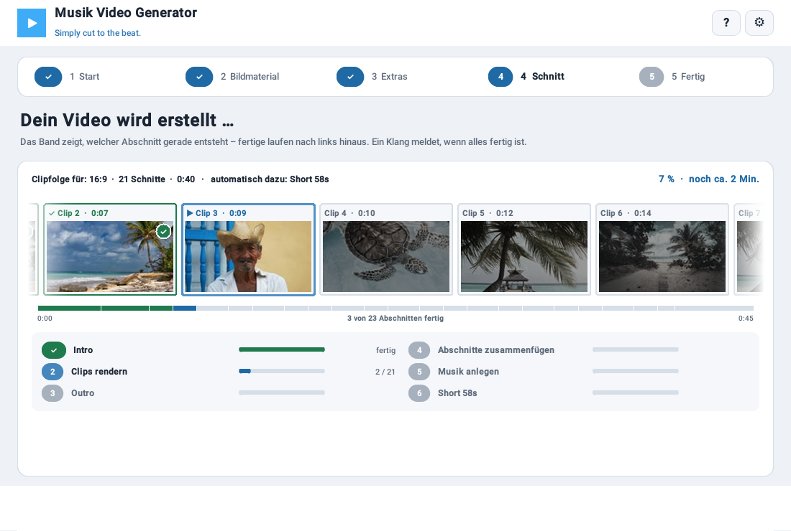
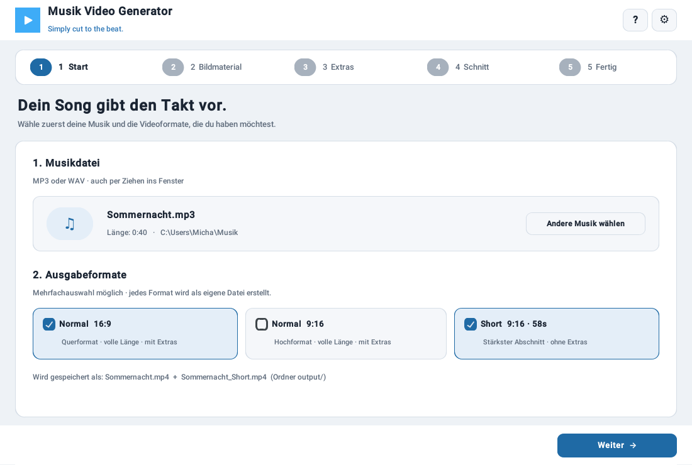
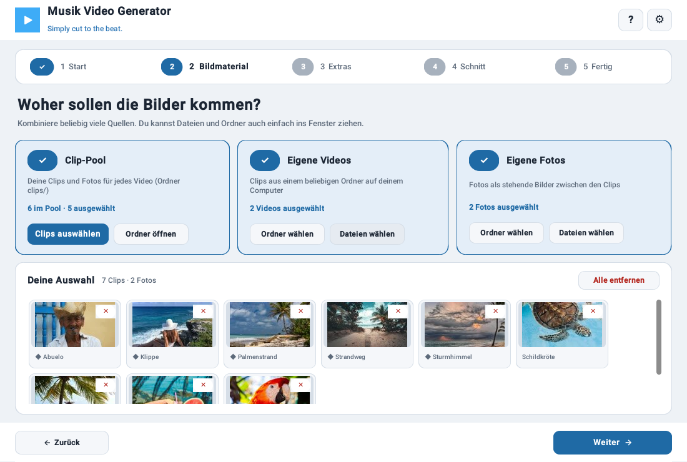
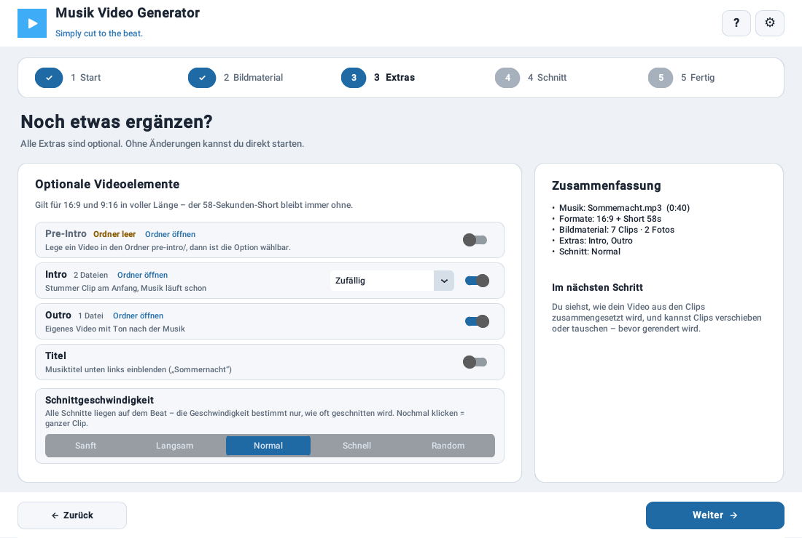
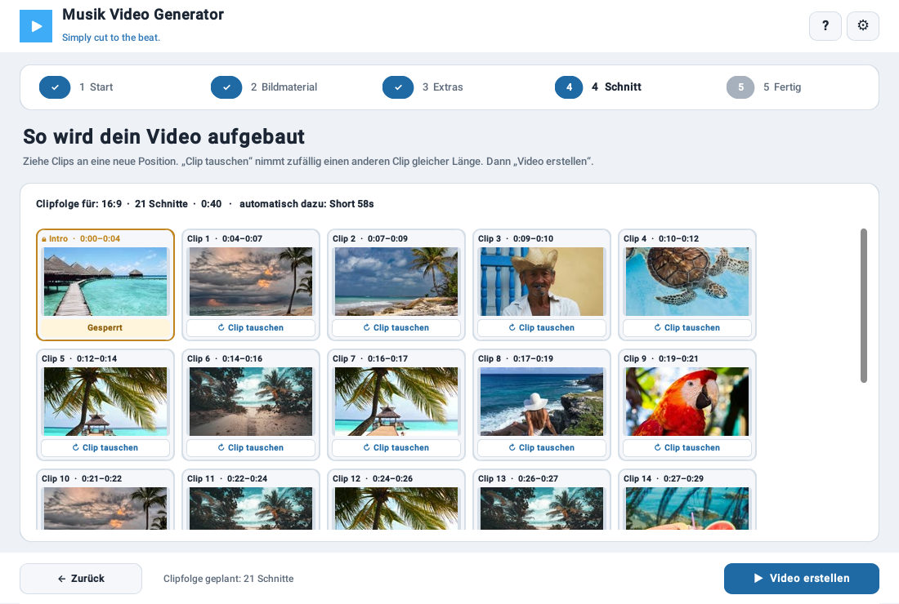
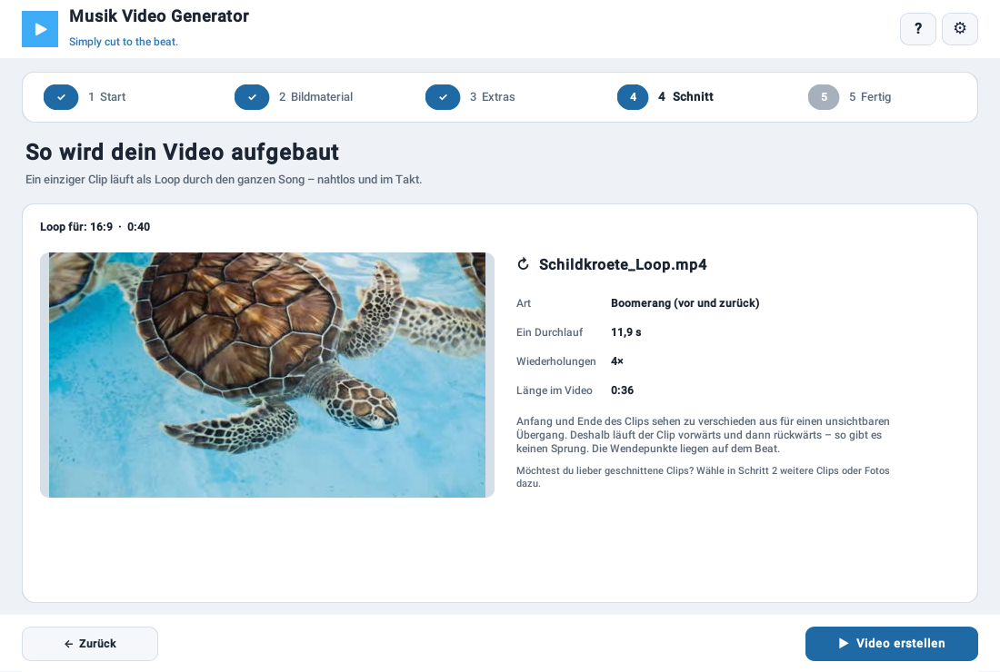
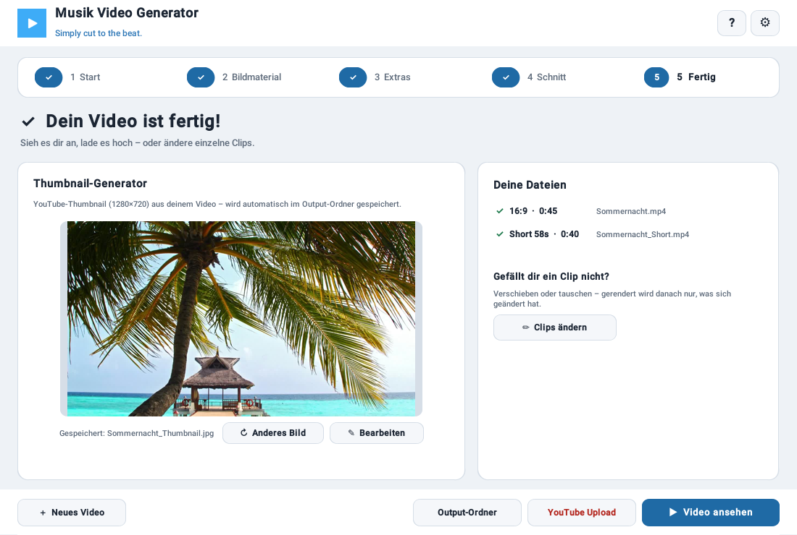
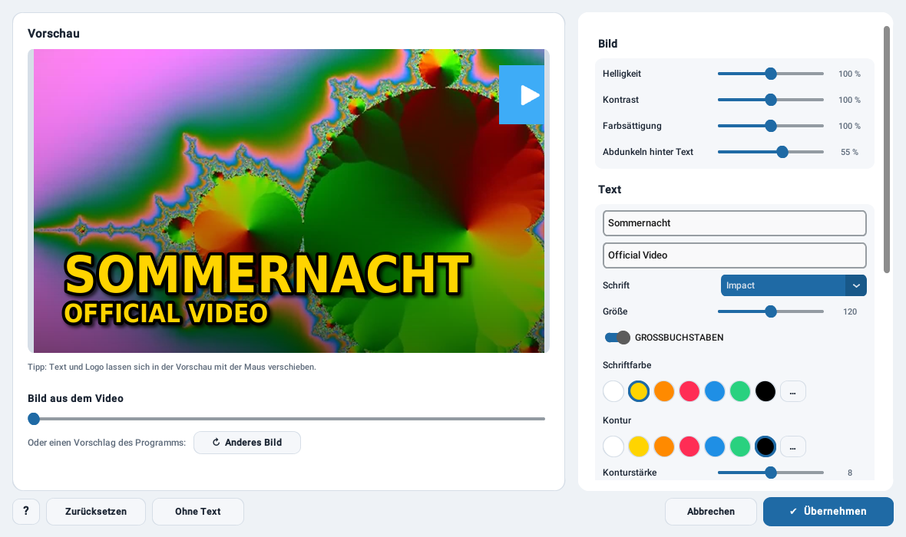

# Musik Video Generator (MVG)

**Simply cut to the beat.**

Ein Windows-Desktop-Tool, das automatisch Musikvideos erstellt: Musik wählen, Clips und Fotos auswählen – das Programm legt die Schnitte per FFmpeg auf den Beat. In fünf Schritten zum fertigen Video, inklusive YouTube-Thumbnail.


## Download

Fertige Windows-EXE (portable, kein Python nötig):
**[→ Releases](../../releases)** · **[Homepage](https://loopweb.github.io/musik-video-generator/)**

## So funktioniert's

| Schritt | Was passiert |
|---|---|
| **1 Start** | Musikdatei wählen (oder ins Fenster ziehen), Formate festlegen: 16:9, 9:16 und/oder 58-Sekunden-Short |
| **2 Bildmaterial** | Clips und Fotos sammeln – aus dem Clip-Pool, aus beliebigen Ordnern oder einfach per Ziehen ins Fenster. Alles landet in einer gemeinsamen Auswahl |
| **3 Extras** | Optional Pre-Intro, Intro, Outro und Titel; Schnittgeschwindigkeit wählen – oder keine, dann läuft jeder Clip ganz |
| **4 Schnitt** | Die geplante Clipfolge wird als Kacheln gezeigt: Clips verschieben oder zufällig tauschen, dann „Video erstellen“. Ein Laufband zeigt live, welcher Abschnitt gerade entsteht |
| **5 Fertig** | Video im Standard-Player ansehen, YouTube-Thumbnail (1280×720) wird automatisch gespeichert, Clips nachträglich ändern, YouTube-Upload öffnen |



## Funktionen

- **Beat-synchrones Schneiden** – Musik wird analysiert, Schnitte automatisch auf den Beat gelegt
- **Mehrere Formate in einem Durchgang** – 16:9, 9:16 und 58-Sekunden-Short (der Short nimmt automatisch den stärksten Songabschnitt, ohne Intro/Outro)
- **Fünf Schnittgeschwindigkeiten** – von sanft bis schnell, oder zufällig gemischt
- **Clip-Pool mit optionalen Kategorien** – ein Ordner `clips/` für immer wieder genutztes Material; Unterordner erscheinen im Auswahlfenster als Reiter
- **Clips und Fotos aus jeder Quelle** – Pool, Ordner, einzelne Dateien oder Drag & Drop
- **Clipfolge vor dem Rendern** – verschieben per Ziehen, „Clip tauschen“ setzt einen anderen Clip gleicher Länge ein
- **Nachträglich ändern** – nach dem Rendern Clips ändern; „Änderungen übernehmen“ rendert nur, was sich geändert hat
- **Live-Ansicht beim Rendern** – Laufband mit den Abschnitten, Übersichtsstreifen und Schritt-Liste mit Fortschrittsbalken
- **Ganzer Clip** – keine Schnittlänge markiert: jeder Clip läuft komplett, geschnitten wird am Clip-Ende auf dem Beat
- **Loop aus einem Clip** – genau ein Clip ausgewählt: er läuft automatisch als nahtloser Loop oder Boomerang durch den ganzen Song, im Takt
- **Thumbnail-Generator** – YouTube-Thumbnail (1280×720, JPG) aus dem eigenen Video, automatisch im Output-Ordner; „✎ Bearbeiten“ öffnet eine Werkzeugpalette mit Bildwahl per Schieberegler, Text, Schriften, Farben, Kontur, Schatten, Logo und Vorlagen
- **Pre-Intro, Intro, Outro, Titel** – optionale Bausteine, Pre-Intro und Outro mit eigenem Ton; Titel automatisch aus dem Dateinamen
- **Drei Sprachen** – Deutsch, English, Español; Wechsel jederzeit ohne Neustart
- **Hell / Dunkel / System** – Darstellung im ⚙-Menü
- **Klick-Hilfe** – „?“ drücken, auf einen Bereich klicken, ausführliche Erklärung lesen (drei Sprachen)
- **Short per URL** – YouTube-Link aus der Zwischenablage → 45-s-Short (9:16) mit stärkstem Abschnitt, Fortschrittsfenster mit allen Schritten
- **Komfort** – Restzeit beim Rendern, weiches Ende ohne Outro, Dateiauswahl merkt sich die letzten Ordner
- **Update-Hinweis** – MVG zeigt oben an, wenn auf GitHub eine neue Version bereitsteht
- **Problem melden** – ein Klick legt einen Fehlerbericht auf den Desktop, den man dem Entwickler schicken kann
- **Mobile Version** – [MVG Mobil](https://github.com/loopweb/mvg-mobil) für unterwegs (iPhone, Safari)

## Screenshots

| | |
|---|---|
|  |  |
|  |  |
|  |  |
|  |  |

## Installation & Nutzung

### Für Anwender

1. Aktuelles Release als ZIP herunterladen und entpacken
2. `MVG.exe` starten – beim ersten Start Sprache wählen; benötigte Unterordner werden automatisch angelegt
3. Videos und Fotos, die du immer wieder verwendest, in den Ordner `clips/` legen (das Programm wird ohne Clips ausgeliefert). Optional Unterordner anlegen, z. B. `clips/Strand/` – sie werden zu Reitern im Auswahlfenster
4. Den fünf Schritten folgen

Ausführliche Anleitung: `MVG_Bedienungsanleitung.pdf` (Deutsch), `MVG_Manual_EN.pdf`, `MVG_Manual_ES.pdf` – in die EXE eingebaut und im Programm über ⚙ → PDF-Anleitung erreichbar (eine PDF neben der EXE hat Vorrang).

**Umstieg von v3.0:** Die alten Stimmungs-Ordner (`clips/traurig/`, `clips/neutral/` …) funktionieren weiter – sie erscheinen jetzt als Reiter im Pool-Auswahlfenster. Wer lieber einen einzigen Ordner möchte, verschiebt die Dateien direkt nach `clips/`.

### Für Entwickler

```bash
git clone https://github.com/loopweb/musik-video-generator.git
cd musik-video-generator
pip install -r requirements.txt
```

**FFmpeg wird benötigt**, ist aber nicht im Repo enthalten (Lizenz/Größe). Lade FFmpeg von [ffmpeg.org](https://ffmpeg.org/download.html) herunter und lege `ffmpeg.exe` / `ffprobe.exe` in einen Ordner `ffmpeg/` im Projektverzeichnis.

Programm starten:

```bash
python gui_step3.py
```

### EXE selbst bauen

```bash
build_exe.bat
```

> **Nicht im Repo enthalten** (müssen zum Selbstbauen ergänzt werden): `ffmpeg/` (ffmpeg.exe, ffprobe.exe), `Sound/done.wav` und `splash.png`. Das Icon (`icon.ico`) liegt im Repo und ist zusätzlich im Programm eingebettet.

Die drei PDF-Anleitungen müssen beim Bauen in `C:\Projekt\` liegen, sie werden in die EXE eingebaut.

Voraussetzung: Python 3.12 und die Pakete aus `requirements.txt` (inkl. PyInstaller und tkinterdnd2 für Drag & Drop). Das Skript erwartet die Dateien unter `C:\Projekt\` – bei Bedarf die Pfade in `build_exe.bat` anpassen. Die fertige EXE liegt danach in `dist/`.

Die Homepage liegt im Ordner `docs/` und wird über GitHub Pages veröffentlicht (Settings → Pages → Branch `main`, Ordner `/docs`).

## Ordnerstruktur

| Ordner | Inhalt |
|---|---|
| `clips/` | Clip-Pool: eigene Videos und Fotos (selbst befüllen); Unterordner = Kategorien |
| `pre-intro/` | Video mit eigenem Ton, läuft vor der Musik (optional) |
| `intro/` | Stummes Intro unter der Musik (optional) |
| `outro/` | Video mit eigenem Ton, läuft nach der Musik (optional) |
| `output/` | Fertige Videos und YouTube-Thumbnails |
| `manual/` | Die drei PDF-Anleitungen (werden beim Start aus der EXE hierher kopiert) |
| `logo/` | Eigene Logos für den Thumbnail-Editor; zu Beginn liegt das MVG-Logo darin |
| `logs/` | Protokolle (Fehler, Ablauf, FFmpeg) – werden automatisch klein gehalten |
| `cache/` | Normalisierungs-, Segment- und Vorschaubild-Cache (automatisch verwaltet) |

Alle Ordner werden beim ersten Programmstart automatisch angelegt. Einstellungen stehen in `mvg_settings.json` neben der EXE, die Protokolle im Ordner `logs/`. Für einen Fehlerbericht: ⚙ → Problem melden.

## Tech-Stack

Python 3.12 · CustomTkinter · tkinterdnd2 · librosa · Pillow · FFmpeg · PyInstaller

## Lizenz

MIT – siehe [LICENSE](LICENSE). © 2026 Michael Beyer (loopweb)

Die fertige EXE enthält FFmpeg ([ffmpeg.org](https://ffmpeg.org)), das unter eigener Lizenz (LGPL/GPL) steht; im Repo selbst ist FFmpeg nicht enthalten. Alle verwendeten Programme und Bibliotheken mit ihren Lizenzen zeigt das Programm unter ⚙ → Über MVG → Lizenzen.

## Entstehung

Ursprünglich entstanden für die Musikvideos von [Don Miguel de Cabarete](https://donmiguel.nicepage.io/).

## Unterstützen

MVG ist kostenlos. Wenn es dir gefällt, freue ich mich über einen Kaffee: **[☕ PayPal](https://www.paypal.com/paypalme/loopweb)**

Fehler gefunden oder eine Idee? → **[Issues](../../issues)**

## Deinstallation

MVG wird nicht installiert. Zum Entfernen einfach den MVG-Ordner löschen (vorher fertige Videos aus `output/` und eigene Clips sichern). Die für „Short per URL“ nachgeladene `tools/deno.exe` liegt ebenfalls in diesem Ordner.
